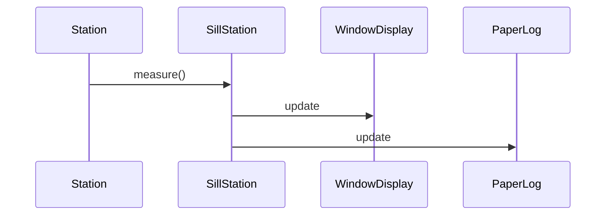

# Guide 11 — Observer

**Lab:** [Requirements](../../phases/phase-11/requirements.md) · [Guided check](../../phases/phase-11/guided-check.md) · [Questions](../../phases/phase-11/questions.md)

## Chapter 11: "A reading from SillStation"

**SillStation** is one small weather station on the windowsill. `measure()` reports `21.5` C. The first build also redraws the window and writes the paper log. A phone would mean teaching `measure()` how a phone works.

You need **Observer**: the station publishes a temperature; each subscriber updates itself.

*Head First Design Patterns* Chapter 2. Refactoring Guru: ([Observer](https://refactoring.guru/design-patterns/observer)).

---

## Learning Objectives

By the end of this guide you will be able to:

- Explain subject/observer responsibilities
- Decouple producers from the set of consumers
- Sketch an in-process event bus
- Bridge the idea to Phase 11 without copying SillStation types

---

## Theory

### Intent

**Observer** defines a one-to-many dependency between objects so that when one object changes state, all its dependents are notified and updated automatically. The subject maintains a list of observers and broadcasts events; observers subscribe and unsubscribe without the subject knowing their concrete types.

*Head First Design Patterns* covers Observer in Chapter 2. Refactoring Guru: publish-subscribe decoupling ([Observer](https://refactoring.guru/design-patterns/observer)).

### The problem in plain language

A core service (`measure()`, `run_automation`, `actuator_fault`) directly calls the live board, audit log, push notifier, metrics, and—next sprint—a WebSocket bridge. Each new consumer edits the producer. Tests must construct every collaborator. Failure in one listener can break the whole operation. The domain event is tangled with presentation and infrastructure.

The smell: **the producer knows all consumers by name**.

### Analogy — the station only measures

Measuring is the station’s only job. Redrawing the window, writing the log, and refreshing the phone are not. Those listeners subscribe and do that work themselves when a temperature is posted. `measure()` only publishes `TemperaturePosted`; each subscriber’s `update()` owns its own reaction.

### Solution structure

| Role | Responsibility | In Phase 11 lab |
| ---- | -------------- | --------------- |
| **Subject / EventBus** | `subscribe`, `unsubscribe`, `publish` | `EventBus` |
| **Observer / Subscriber** | Reacts to events | `AlertPersistenceSubscriber`, … |
| **Event** | Immutable payload | `reading.created` (`device_id`, `value`, `unit`, `source`, `recorded_at`, `zone_id` from the device or null); threshold-crossed; command-failed |
| **Publisher** | Raises events after domain action | Reading ingest, command invoker |

Phase 12 adds a **WebSocket subscriber**—same bus, different transport. Do not rebuild pub/sub inside the socket layer.

### How collaboration works



The station publishes. The window and the log update themselves. The phone does the same in the code below. Subscribers should be **fast or async**; heavy work belongs in queued handlers, not blocking `publish`.

### When to use / when to skip

**Use Observer when:**

- One domain action must fan out to many independent reactions (UI, persistence, alerts, metrics).
- New subscribers appear frequently without changing producers.
- You want a single seam for real-time push later.

**Skip or simplify when:**

- Only one listener will ever exist—a direct call is simpler.
- Ordering guarantees are strict and complex—consider explicit workflows or message queues with contracts.
- Events become a hidden global dependency graph—document event types and keep catalogs small.

### Related patterns

- **Mediator** — observers often communicate only via the bus; Mediator centralizes interaction logic more aggressively.
- **Command** — command execution can **publish** events; Command captures intent, Observer propagates outcomes.
- **Pub/Sub messaging** — Observer at process scale; same idea with brokers (Kafka, RabbitMQ) between services.

---

# Part 2 — Follow along

> **Follow along:** Stdlib Python only. Run the problem demo first, then the complete observer script.

## 1. The sticky problem

Same afternoon. The station has a new reading. It still redraws the window and writes the log itself.

### 1.1 Smell: the station does every update

```python
# Measuring is not enough. The station also knows how the window and the log work.
window.show(21.5)
log.note(21.5)
```

**Root cause:** The producer is coupled to a fixed set of consumers.

### 1.2 Runnable problem demo

> **Follow along:** Save as `sillstation_before.py`, run `python sillstation_before.py`.

```python
"""Afternoon at SillStation. The station updates every display itself."""


class Window:
    def show(self, celsius: float) -> None:
        print(f"The station updates the window to {celsius} C.")


class Log:
    def note(self, celsius: float) -> None:
        print(f"The station writes {celsius} C in the log.")


class SillStation:
    """Subject, still doing the subscribers' jobs."""

    def __init__(self, window: Window, log: Log) -> None:
        self.window = window
        self.log = log

    def measure(self) -> None:
        celsius = 21.5
        self.window.show(celsius)
        self.log.note(celsius)


if __name__ == "__main__":
    print("The station measures 21.5 C.")
    SillStation(Window(), Log()).measure()
    print("PAIN: the station also has to know how a phone works")
```

**Expected output (problem):**

```text
The station measures 21.5 C.
The station updates the window to 21.5 C.
The station writes 21.5 C in the log.
PAIN: the station also has to know how a phone works
```

### What goes wrong when requirements change

A phone means teaching `measure()` how a phone refreshes. Every new display is another edit in the station.

---

## 2. Pattern in practice

The window, the log, and the phone take their own work back. `measure()` only says a temperature is ready.

---

## 3. Building the solution (step by step)

### Step A — A temperature, and a subscriber who reacts

```python
@dataclass(frozen=True)
class TemperaturePosted:
    celsius: float


class Observer(ABC):
    @abstractmethod
    def update(self, event: TemperaturePosted) -> None:
        """The subscriber owns this reaction. The station does not."""
        ...
```

### Step B — The station notifies a list

```python
def notify(self, event: TemperaturePosted) -> None:
    for observer in list(self._observers):
        observer.update(event)  # each subscriber updates itself
```

### Step C — measure only publishes

```python
self.notify(TemperaturePosted(21.5))  # no window or log imports
```

---

## 4. Complete worked solution (runnable)

> **Follow along:** Save as `sillstation_observer.py`, run `python sillstation_observer.py`.

```python
"""Later that afternoon. The station measures. Subscribers update themselves (stdlib only)."""

from abc import ABC, abstractmethod
from dataclasses import dataclass


@dataclass(frozen=True)
class TemperaturePosted:
    celsius: float


class Observer(ABC):
    """Subscriber. update() is this listener's own job."""

    @abstractmethod
    def update(self, event: TemperaturePosted) -> None:
        ...


class SillStation:
    """Subject. It keeps the list and publishes. It does not redraw anyone."""

    def __init__(self) -> None:
        self._observers: list[Observer] = []

    def subscribe(self, observer: Observer) -> None:
        self._observers.append(observer)

    def unsubscribe(self, observer: Observer) -> None:
        self._observers.remove(observer)

    def notify(self, event: TemperaturePosted) -> None:
        for observer in list(self._observers):
            observer.update(event)

    def measure(self) -> None:
        self.notify(TemperaturePosted(21.5))


class WindowDisplay(Observer):
    def update(self, event: TemperaturePosted) -> None:
        print(f"The window updates itself to {event.celsius} C.")


class PaperLog(Observer):
    def update(self, event: TemperaturePosted) -> None:
        print(f"The log writes {event.celsius} C itself.")


class Phone(Observer):
    """A new subscriber. measure() does not grow a phone call."""

    def update(self, event: TemperaturePosted) -> None:
        print(f"The phone updates itself to {event.celsius} C.")


if __name__ == "__main__":
    station = SillStation()
    station.subscribe(WindowDisplay())
    station.subscribe(PaperLog())
    station.subscribe(Phone())
    print("The station measures 21.5 C again.")
    station.measure()
    print("The station only said that a temperature was ready.")
```

**Expected output (solution):**

```text
The station measures 21.5 C again.
The window updates itself to 21.5 C.
The log writes 21.5 C itself.
The phone updates itself to 21.5 C.
The station only said that a temperature was ready.
```

---

## 5. Compare & contrast

| | Observer | Facade (Guide 07) |
|--|----------|-------------------|
| Goal | Fan-out notifications | Simplify calling a subsystem |
| Change style | Add subscribers | Add façade methods carefully |

---

## 6. Watch out for these traps

- One observer throwing and aborting the notify loop
- Re-implementing the bus inside WebSocket handlers in Phase 12
- Pasting SillStation types into the greenhouse alert model

---

## 7. Try this

`unsubscribe` the window, call `measure()` again, and the window stays quiet. `measure()` stays unchanged. The window's reaction left with the subscriber.

---

## Key Terms

| Term | Definition |
|------|------------|
| **Observer / subscriber** | Object notified of events |
| **Subject / publisher** | Maintains subscribers and notifies them |
| **Event** | Immutable message describing what happened |
| **Fan-out** | One event delivered to many listeners |

---

## Reading Assignments

**Required:**

- *Head First Design Patterns* — Chapter 2
- [Refactoring Guru — Observer](https://refactoring.guru/design-patterns/observer)
- Lab: [Requirements](../../phases/phase-11/requirements.md) · [Guided check](../../phases/phase-11/guided-check.md) · [Questions](../../phases/phase-11/questions.md)

---

## Bridge to your lab

Phase 11 introduces in-process pub/sub for readings/events → alerts, metrics, feeds. WebSocket in Phase 12 should subscribe to the same seam.

| Teaching (this guide) | Your lab (greenhouse) |
| --------------------- | --------------------- |
| `SillStation` / `measure` | Application services that **publish** after persist |
| `TemperaturePosted` | `reading.created` (`device_id`, `value`, `unit`, `source`, `recorded_at`, and `zone_id` copied from the device); also threshold-crossed and command-failed |
| `WindowDisplay` / `PaperLog` / `Phone` | `AlertSubscriber` (and optional metrics) |
| Observer list on the subject | `EventBus.subscribe` / `publish` |

**Do / don’t:** **Do** publish `reading.created` from ingest only when `tracking_enabled` is true, and copy `zone_id` from the device at publish time. Leave `zone_id` null when the device is unassigned. Manual read, the sampler, and MQTT translation share that publish. Wire the bus once in the composition root; publishers must not import `AlertRepository`. **Don’t** open WebSockets in this phase (the feed polls; `realtime.ts` is a stub), don’t invent a `zone_id` for an unassigned device, and don’t call alert persistence from the reading router.

---

## Summary

- Hard-wiring listeners into producers blocks extension.
- Observer lets subjects broadcast; subscribers opt in.
- Later realtime transports plug into the same event model.

**Next:** [Guide 12 — API, WebSocket & hardening](./12-api-websocket-hardening.md)
